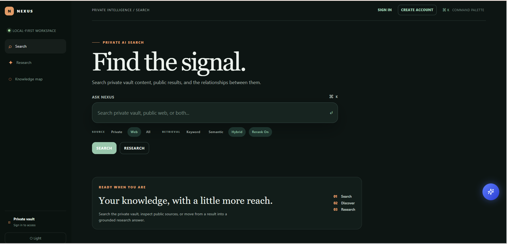
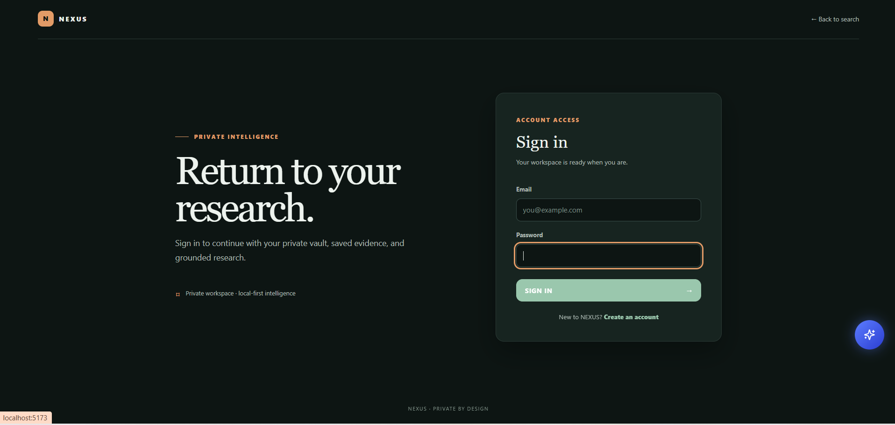

# NEXUS — Private AI Search Engine

## Project Overview

NEXUS is a privacy-focused AI/ML engineering project exploring local document retrieval, hybrid ranking, evidence-grounded research, secure document access, and knowledge discovery in a single application.

Its architecture separates ingestion, retrieval, reranking, research, graph operations, storage, and the frontend so that these components can be tested and improved independently.

A local-first AI search and research workspace for private documents and explicitly selected public web sources. NEXUS combines keyword retrieval, semantic embeddings, hybrid ranking, local reranking, citation-backed AI research, and a bounded knowledge graph—all designed to keep private document content on your machine.

## Interface Preview

### Search Workspace



### Account Access



### Research Mode


### Knowledge Map


## Key Features

- **\*\*Private Document Search:\*\*** Index and search TXT, Markdown, and PDF documents.

- **\*\*User-Scoped Private Vaults:\*\*** Cookie-based authentication and per-user private document isolation.

- **\*\*Hybrid Retrieval:\*\*** Combine BM25 keyword search with semantic retrieval.

- **\*\*Local Reranking:\*\*** Use a CrossEncoder model to refine search result ordering.

- **\*\*AI Research Mode:\*\*** Generate citation-backed research using a locally running Ollama model.

- **\*\*Public Web Search:\*\*** Explicitly crawl selected public pages with bounded requests and safety checks.

- **\*\*Knowledge Discovery:\*\*** Explore concepts and evidence-backed relationships in a local SQLite knowledge graph.

- **\*\*Privacy-Focused Design:\*\*** Keep private document processing, embeddings, retrieval, reranking, graph storage, and research local.

- **\*\*Developer Tooling:\*\*** API documentation, automated tests, security checks, evaluation scripts, and Docker deployment assets.

## Quick Start

### 1. Prerequisites

Install the following:

- Python 3.12

- Node.js and npm

- Git

- Ollama, if you want to use AI Research Mode

### 2. Install dependencies

Run these commands from the project root in PowerShell:

```powershell

py -3.12 -m venv .venv

.\\.venv\Scripts\Activate.ps1

python -m pip install -r requirements.txt

Push-Location frontend

npm install

Pop-Location

Copy-Item .env.example .env

python -m scripts.setup

python -m scripts.prepare_models

python -m scripts.demo_setup

```

Model preparation downloads the required model files into the local cache. The initial setup may take time and requires an internet connection.

### 3. Start the backend

Open a terminal at the project root:

```powershell

.\\.venv\Scripts\Activate.ps1

$env:PYTHONPATH="."

python -m uvicorn backend.app.main:app --host 127.0.0.1 --port 8000

```

### 4. Start the frontend

Open a second terminal:

```powershell

cd frontend

npm run dev

```

Open the local frontend in your browser:

http\://localhost:5173

Keep both development terminals running while using the application.

## Model Setup

NEXUS uses the following default models:

\| Component | Model |

\| --- | --- |

\| Embeddings | `sentence-transformers/all-MiniLM-L6-v2` |

\| Reranker | `cross-encoder/ms-marco-MiniLM-L-6-v2` |

\| Local LLM | Ollama model `llama3.2:1b` by default |

Prepare and verify local models:

```powershell

python -m scripts.prepare_models

python -m scripts.verify_models

```

The configured local Ollama model must also be installed and available for AI Research Mode. Model preparation and runtime inference are separate operations.

## Documentation

- [Deployment Guide](docs/DEPLOYMENT.md)

- [API Documentation](docs/API.md)

- [Architecture](docs/ARCHITECTURE.md)

- [Privacy](docs/PRIVACY.md)

- [Security](docs/SECURITY.md)

- [Performance](docs/PERFORMANCE.md)

- [Evaluation](docs/EVALUATION.md)

- [Testing](docs/TESTING.md)

- [Development](docs/DEVELOPMENT.md)

## How NEXUS Works

### Document Ingestion and Indexing

NEXUS supports private document indexing for `.txt`, `.md`, and `.pdf` files.

The indexing pipeline extracts text, cleans and chunks documents, and stores indexing metadata and chunk text in local SQLite storage. Unchanged files can be skipped during re-indexing; changed and deleted files are handled by the indexing workflow.

The bundled demonstration documents are located in:

```text

private_vault/documents/

```

Authenticated users' documents are stored beneath their user-specific vault directories:

```text

private_vault/documents/users/\<user_id>/documents/

```

Rebuild the authenticated user's index through:

```text

POST /api/index/rebuild

```

The indexing CLI is also available:

```powershell

python -m indexer.cli

```

Private source responses expose filenames rather than absolute filesystem paths.

### Two-Stage Retrieval

NEXUS separates candidate retrieval from result reranking.

**Stage 1 — Candidate retrieval**

Retrieve relevant candidates using keyword, semantic, or hybrid retrieval.

**Stage 2 — Reranking**

Optionally refine the candidate ordering using the local CrossEncoder reranker. If the reranker is unavailable, the search pipeline can fall back to the original hybrid ordering.

Example request:

```text

GET /api/search?q=machine%20learning&mode=hybrid&rerank=true

```

Available retrieval approaches include:

- BM25 keyword retrieval

- Semantic retrieval using local embeddings

- Hybrid retrieval

- Optional CrossEncoder reranking

### AI Research Mode

Search returns ranked sources. Research uses retrieved evidence to generate a cited synthesis through the configured local Ollama model.

The research workflow builds a bounded context from retrieved sources, generates a response, validates citation references, and returns supporting evidence and related topics.

Endpoint:

```text

POST /api/research

```

Example request:

```json

{

  "query": "How does machine learning learn from data?",

  "mode": "hybrid",

  "top_k": 5

}

```

Research is designed to use local inference for private context. If relevant evidence is unavailable, the application can return an evidence limitation rather than asking the model to answer without retrieved support.

### Public Web Search

Public web ingestion is explicit and bounded. It is available through:

```text

POST /api/crawl

```

Example request:

```json

{

  "url": "https\://example.com/article",

  "max_pages": 5,

  "max_depth": 1

}

```

The crawler validates URLs and redirects, blocks local and private destinations by default, checks `robots.txt`, and applies page, depth, response-size, and timeout limits.

NEXUS is not a general-purpose internet crawler or a continuously maintained web index.

Search supports three source modes:

- `private` — the authenticated user's private documents.

- `web` — explicitly crawled public pages.

- `all` — combined retrieval over the authenticated user's private documents and indexed public pages.

Public web search can be used without an account. Private and combined retrieval require a valid session.

Private and public results preserve their source provenance. Private results avoid exposing local filesystem paths.

### Knowledge Discovery

NEXUS builds a local knowledge graph from indexed content:

```text

Search → Results → Concepts → Relationships → Exploration

```

Concepts are extracted deterministically from meaningful local phrases.

- `MENTIONS` edges connect source nodes to concepts.

- `RELATED_TO` edges represent concepts that co-occur within an indexed chunk.

- Relationships record their extraction method, weight, and evidence count.

Graph data is stored in:

```text

database/knowledge_graph.db

```

Rebuild the graph through:

```text

POST /api/graph/rebuild

```

The graph API supports bounded concept neighborhoods, related concepts, supporting sources, and graph search.

Private source nodes expose limited metadata rather than absolute filesystem paths.

## Evaluation and Results

NEXUS includes a project-specific retrieval evaluation workflow to compare ranking approaches.

Prepare the sample index and local models, then run:

```powershell

python -m evaluation.run

```

The evaluation covers retrieval methods such as BM25, semantic retrieval, hybrid retrieval, and hybrid retrieval with reranking.

The main metrics are:

\| Metric | Meaning |

\| --- | --- |

\| Precision | Fraction of retrieved results that are relevant |

\| Recall | Fraction of relevant items retrieved |

\| MRR | Reciprocal rank of the first relevant result |

\| NDCG | Ranking quality that accounts for the positions of relevant results |

**\*\*Evaluation scope:\*\*** The dataset is small and project-specific, based on sample documents. Results are useful for regression testing and comparing configurations; they should not be interpreted as proof of general-world search quality.

Run the command above to obtain the current results. See [Evaluation](docs/EVALUATION.md) for the evaluation setup and recorded results.

## Performance Testing

Run the controlled performance benchmark:

```powershell

python -m scripts.performance_check

```

It measures keyword, semantic, hybrid, and reranked search, along with graph rebuild and graph query operations using synthetic content and temporary local storage.

Measurements depend on the workload and machine. Use the actual output from each run when reporting performance.

## Testing and Continuous Integration

Run the project tests and checks:

```powershell

python -m unittest discover -s tests -p "test\_\*.py" -q

python -m scripts.security_check

python -m scripts.performance_check

Push-Location frontend

npm run build

Pop-Location

```

GitHub Actions is configured to run Python compilation, tests, security checks, and the frontend build without downloading model weights during standard CI.

## Security and Privacy

NEXUS is designed around local-first private document processing.

- Private document extraction, indexing, embeddings, retrieval, and reranking run locally.

- Private research context is intended for the configured local Ollama service rather than a hosted LLM API.

- Private document storage and indexing records are scoped by user.

- Browser sessions use an HttpOnly cookie rather than storing session tokens in browser storage.

- Private document indexing allows `.txt`, `.md`, and `.pdf` files, skips symlinks, and restricts discovery to the configured vault.

- Public crawling is explicit and bounded, with URL and redirect validation and protections against local or private destinations by default.

- API responses are designed to avoid exposing absolute filesystem paths, private document contents, or stack traces.

- Health and readiness endpoints provide operational status without intentionally exposing private document contents.

Hugging Face access is used during explicit model preparation. Runtime model loading is intended to use the local cache.

Run the local security audit:

```powershell

python -m scripts.security_check

```

For production deployments, configure the environment, secure cookies, and explicit HTTPS CORS origins. Keep `.env` ignored by Git and leave `CRAWLER_ALLOW_LOCALHOST=false` unless a deliberate, reviewed configuration requires otherwise.

These are project design goals and implemented controls, not a guarantee that every deployment is secure. Review the [Security](docs/SECURITY.md) and [Privacy](docs/PRIVACY.md) documentation before exposing an instance to other users or networks.

## Docker Deployment

The Compose configuration is located at:

```text

deployment/docker-compose.yml

```

Production mode expects explicit HTTPS origins served through a trusted TLS reverse proxy. Configure the actual frontend and API origins for your deployment:

```powershell

$env:NEXUS_PRODUCTION_CORS_ORIGINS='["https\://search.example.com"]'

$env:NEXUS_PRODUCTION_API_URL='https\://api.example.com'

```

Replace the example domains with your real origins, then run:

```powershell

docker compose -f deployment/docker-compose.yml up --build -d

```

The Compose setup exposes frontend port `8080` and backend port `8000` for reverse-proxy integration, preserves local runtime data, and expects Ollama on the host by default.

The HTTP port mappings are not themselves a production TLS endpoint. See the [Deployment Guide](docs/DEPLOYMENT.md) before deploying.

## Project Structure

```text

backend/          FastAPI application, authentication, and services

frontend/         React and Vite user interface

retrieval/        Retrieval components

reranker/         Local reranking

search_engine/    Search orchestration

indexer/          Private document ingestion and indexing

crawler/          Bounded public web ingestion

knowledge_graph/  Graph storage and queries

database/         SQLite repositories and local data

ai_engine/        Local AI research and grounding

scripts/          Setup, verification, audit, and benchmark tools

tests/            Automated regression tests

docs/             Technical documentation

```

## Known Limitations

- AI Research Mode requires an installed and available local Ollama model.

- Model preparation is separate from runtime inference.

- Public crawling is explicitly initiated and bounded; NEXUS is not a general web indexer.

- Evaluation uses a small project-specific dataset.

- Performance measurements depend on the local hardware and workload.

- Hosted inference and managed cloud deployment infrastructure are not included.

## Data and Local Backups

Back up the source documents and associated local databases together when preserving a working instance:

```text

private_vault/documents/

database/nexus.db

database/vectors.db

database/knowledge_graph.db

```

Source documents are authoritative; indexes can be rebuilt locally. Never commit `.env`, session secrets, private documents, or personal database contents to the repository.

## License

This project is licensed under the MIT License. See [LICENSE](LICENSE) for details.
